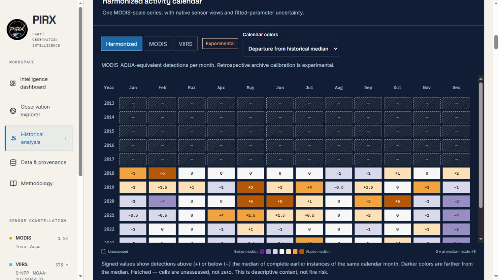

# PIRX — Satellite fire history

PIRX is a web application for exploring NASA FIRMS MODIS and VIIRS thermal detections, building a MODIS-scale burning-activity calendar, and comparing months with their historical context.

**Start here:** [Judge walkthrough and requirement-to-code table](docs/judges.md).



## What you can explore

- Draw a rectangle or polygon, enter latitude/longitude bounds, and apply the same area to the map and historical analysis.
- Switch **Harmonized / MODIS / VIIRS**. Inspect model status, source identity, missing months and fitted-parameter uncertainty.
- Color the calendar by **activity intensity** or **departure from the historical median**, with signed values, labeled legends and colorblind-safe scales.
- Export observations, monthly comparisons, the harmonized calendar, analysis JSON and chart SVGs with provenance.

The scientific calculations run in testable Python functions. FastAPI loads the archive; React displays the results. Shared calendar types are generated from the backend schema. Optional Gemini narration uses bounded Python evidence and a server-only key.

## Run the application

Requirements: Docker Engine/Desktop with Compose v2. For a fresh checkout, create `.env` from `.env.example`; preserve any existing configuration. Then run from the repository root:

```sh
docker compose --env-file .env -f infrastructure/compose.yaml up --build -d
```

Open [PIRX](http://localhost:8080) or [API documentation](http://localhost:8000/docs). A fresh database contains sensor metadata and shows an empty archive until real observations are imported.

For the existing Windows workstation, use [local runtime and restart instructions](docs/local-runtime.md); its development UI is [localhost:5173](http://localhost:5173). For a fresh Python/Node setup, see [local development](docs/development.md).

## Load real data from 2000 through today

In the installed project environment:

```sh
pipeline backfill --region jordan
```

Windows without activating the virtual environment:

```powershell
.\.venv\Scripts\pipeline.exe backfill --region jordan
```

Stop with **Ctrl+C**, then repeat the command to resume. Annual country files, standard API products and NRT tails are selected from NASA's current availability. Missing dates and pre-operational sensor periods are reported explicitly; they are never converted to observed zeros. `MAP_KEY` is server-side and optional for annual files, required for API tails.

On November 15, 2026, the real Jordan rerun skipped all **40** committed annual files and found its four API ranges up to date. The archive retained **13,079** normalized detections. The S-NPP API fetch plan ends November 2 and records the unsupported tail. See the [measured backfill summary](docs/reports/backfill-judges-summary.json) and [backfill guide, including Docker](docs/backfill.md).

## Scientific status

**Harmonization is experimental unless a registered model passes the scope-specific approval checks.** The Jordan and supplementary Levant calibration studies both decline operational use. Regression and quantile mapping can produce a retrospective reference-scale calendar; improved sensor agreement does not establish physical fire truth.

Median colors use complete earlier instances of the same calendar month. Unknown completeness, insufficient history, extrapolation and unapproved mapped values remain unassessed. Bootstrap bands describe fitted-parameter uncertainty, not prediction intervals. Thermal detections are not unique fires, burned area or fire-risk forecasts. Environmental causation and operational forecasting are not implemented.

Read the [harmonized-calendar contract](docs/harmonized-calendar.md), [accessibility and color rules](docs/accessibility.md), [measured calibration findings](docs/harmonization-results.md), and [science contract](docs/science.md).

## Verify and reproduce

```powershell
.\.venv\Scripts\python.exe -m pytest -q
pnpm --dir frontend test
pnpm --dir frontend build
.\.venv\Scripts\python.exe scripts/generate_calendar_types.py
```

PostGIS tests use an isolated disposable schema when `TEST_DATABASE_URL` is configured. [Verification details](docs/verification.md) and [local development commands](docs/development.md) explain database-backed checks and offline replay. Synthetic test fixtures are isolated from the application archive; no observations are fabricated for the demo.

## Code and documentation

| Location | Responsibility |
| --- | --- |
| `backend/app/` | API, shared contracts, pure historical/calendar statistics |
| `data-pipeline/firescope_pipeline/` | FIRMS validation, backfill, transactional ingestion and calibration |
| `frontend/src/` | Map, calendars, accessible scales, charts and exports |
| `tests/` | Numerical, API, parser, interruption/resume and PostGIS checks |
| `docs/` | Judge evidence, methods, screenshots and reproducibility |
| `infrastructure/` | PostGIS, API and frontend containers |

Further references: [architecture](docs/architecture.md), [ingestion](docs/ingestion.md), [API](docs/api.md), [operations](docs/operations.md), [map drawing](docs/map-drawing.md), [Gemini intelligence](docs/gemini-intelligence.md).

Data attribution: [NASA FIRMS / EOSDIS](https://firms.modaps.eosdis.nasa.gov/content/active_fire/). Source checksums, product versions, processing levels and retrieval timestamps are retained. PIRX is an independent Space Apps project, not an official NASA service.
