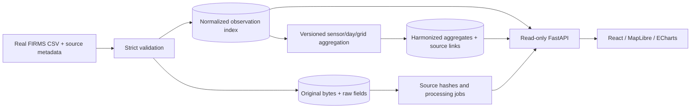

# Architecture

FireScope separates immutable scientific inputs, reproducible transformations, and read-only exploration. A trusted operator invokes the pipeline CLI for local historical files or optional MAP_KEY API sync. There is no scheduler, ML subsystem or unauthenticated write endpoint. See [ingestion](ingestion.md) for the current storage and checkpoint contract.

## Module boundaries

- `backend/app/core/config.py`: environment validation and configuration.
- `backend/app/models.py`: database mappings; Alembic owns schema changes.
- `backend/app/schemas.py`: spatial/time query validation.
- `backend/app/repository.py`: parameterized spatial selection and summaries.
- `backend/app/main.py`: HTTP contract and sanitized operational errors.
- `data-pipeline/firescope_pipeline/ingest.py`: strict CSV parsing, no database side effects.
- `harmonize.py`: pure Pandas/NumPy aggregation returning a GeoPandas layer.
- `jobs.py`: separately committed audit lifecycle and atomic output transactions.
- `cli.py`: operator commands, source archiving, input snapshots and output persistence.
- `frontend/src/api.ts`: typed API integration, error handling and UTC date boundaries.
- `frontend/src/components/`: MapLibre, ECharts and original-record inspector lifecycle.
- `frontend/src/pages/`: explorer, source/job catalog and methodology routes.

## Database design

| Table | Responsibility | Provenance / uncertainty |
| --- | --- | --- |
| `sensors` | Platform and instrument registry | Native confidence scheme, nominal resolution, metadata URL |
| `source_files` | Immutable source archive | Exact CSV bytes, SHA-256, URL, original filename, retrieval/import time, version, NRT/standard status |
| `raw_observations` | Preserved legacy v1 archive, no new inserts | Source file/row, all original string fields, native confidence, uncertainty flags |
| `processing_jobs` | Audit lifecycle | Parameters, method version, start/finish time, status, output lineage, sanitized failure |
| `harmonized_aggregates` | Derived sensor/day/angular-cell summary | Job ID, counts, known FRP count/sum, unknown quantitative uncertainty |
| `aggregate_sources` | Exact input manifest per aggregate job | Links the job to immutable source files used in its observation snapshot |
| `analytical_results` | Future versioned non-ML analytical outputs | Method, job, parameters, result JSON and uncertainty JSON; no results fabricated or pre-seeded |

The generated PostGIS observation point uses stored WGS84 coordinates, preventing a stale geometry when inserts are made. GiST indexes support point/cell spatial queries. Time/sensor and source indexes support exploration and lineage. SQL constraints reject invalid numeric ranges and status values. Database triggers reject UPDATE, DELETE and TRUNCATE of source and raw tables; corrections require new source files/products. A database administrator can still alter/drop schema objects, so these are integrity controls rather than a substitute for database access policy.

Concurrent imports serialize on a transaction-scoped advisory lock. Source content/context uniqueness, source-row uniqueness and normalized payload hashes enforce idempotence. Import data and a successful job result commit together; processing failures roll back all new inputs/outputs and mark the separately persisted job as failed. An interrupted process may leave a running job; see operations.

Aggregation uses one bounded SELECT statement as the consistent input snapshot. Sensor/day/grid outputs are append-only by processing job convention; consumers select a successful job ID explicitly. Re-running creates a new version rather than overwriting a previous run. Source IDs plus job interval and method version reproduce membership; individual raw observation IDs remain queryable.

Migration `0002_ingestion` adds immutable `raw_records`, canonical `normalized_observations`, `observation_records` provenance links, `data_quality_reports`, and transactional `import_checkpoints`. The API and new grid jobs read normalized observations; original fields come from linked raw records. Legacy raw data and existing derived jobs remain unchanged. Source content uniqueness now includes sensor/product/processing context, allowing identical zero-row CSV responses from different sources.

The ingestion modules additionally separate pure selection/validation (`selection.py`, `ingest.py`), persistence (`service.py`), bounded HTTP transport (`firms_api.py`) and resumable orchestration (`sync.py`). Quality reports record row errors and missing values without inventing observations. Normalized identity is exact complete payload plus resolved sensor/native version/processing level. The importer serializes operator imports with a transaction-scoped advisory lock and uses database unique constraints for canonical identities. New source bytes, raw records, normalized rows, links, quality report and any checkpoint advancement commit together.

## Geographic and temporal semantics

All geometry uses longitude/latitude in EPSG:4326; acquisition times are timezone-aware and stored as `timestamptz`. Day grouping is explicitly UTC, independent of the database session timezone. Time windows are `[start, end)`. Bboxes include boundaries; west > east wraps across the antimeridian. Polygon/MultiPolygon queries include exterior boundaries using `ST_Covers`, respect holes, and require valid finite 2D coordinates. Polygons spanning longitude discontinuities must be split into a MultiPolygon. Bbox and polygon filters intersect if both are supplied.

## Scope and limits

This is an operator-run local foundation. Import limit: 50 MiB / 250,000 rows per file. Aggregation limit: 1 million rows per job, in memory. The frontend plots at most 2,000 records and exports only that visible page with truncation metadata. The API returns at most 5,000 rows per observation page; summary statistics use the entire matching query. Large deployments need partitioning, spatial tiles, object storage instead of `bytea`, background execution, query budgets, controlled database roles and authenticated ingestion. See operations before exposing any service.
