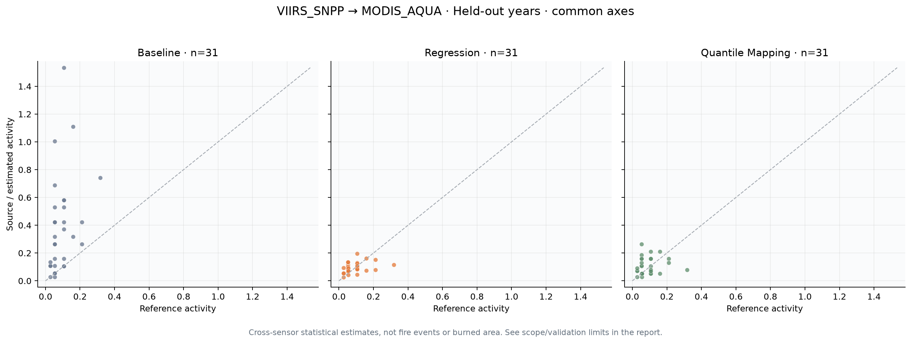
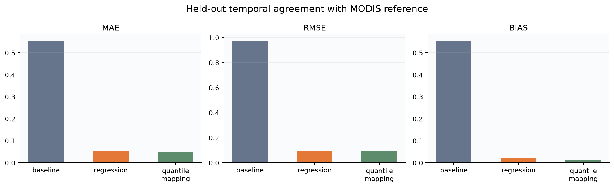

# FireScope measured harmonization results

Both demonstrations decline operational calibration. These are conditional comparisons of reported detections against a sensor reference, not estimates of unique fires, burned area or detection truth.

Primary methodology, definitions and reproduction commands: [methodology](harmonization-methodology.md).

All error values below use reported flagged-cell days per 1,000 km² per month. Error sign is estimate minus MODIS Aqua reference. Training years: 2013–2019; validation: 2020–2021; temporal test: 2022–2025.

| Study / held-out scope | Paired bins | Baseline MAE | Selected candidate | Candidate MAE | Candidate RMSE | Candidate bias |
| --- | ---: | ---: | --- | ---: | ---: | ---: |
| Jordan / test_years | 31 | 0.296360 | regression | 0.043050 | 0.060343 | 0.003145 |
| Jordan / test_regions | 0 | not estimable | regression | not estimable | not estimable | not estimable |
| Jordan / test_years_and_regions | 0 | not estimable | regression | not estimable | not estimable | not estimable |
| Supplementary Levant / test_years | 74 | 0.556002 | quantile_mapping | 0.048040 | 0.093816 | 0.011525 |
| Supplementary Levant / test_regions | 44 | 2.627403 | quantile_mapping | 0.308129 | 0.398937 | 0.165291 |
| Supplementary Levant / test_years_and_regions | 31 | 2.520389 | quantile_mapping | 0.422810 | 1.000346 | -0.106377 |

## Why neither candidate is enabled

### Jordan

Study ID: `55c5649b67efaceb575ddfd6219203584e79f151dae4ddef8a24794c28caa0ab`.
Input normalized records: 9,225; retained common-grid detections: 8,744 (all retained sensor/day-night strata).
Paired selected-stratum bins: 95; unknown/unpaired calendar bins: 529, including 334 with both sensors missing.

- test_years:trend_not_estimable
- test_regions:insufficient_pairs
- test_years_and_regions:insufficient_pairs
- observability_unknown_conditional_detection_comparison_only
- metric_is_detection_only_proxy
- native_product_transition_evaluation_only

Temporal MAE 95% year-block bootstrap interval: [0.029730, 0.056083], based on 4 held-out year blocks. This quantifies finite-sample agreement variability, not physical fire uncertainty.

[Detailed result report](reports/harmonization/jordan/report.md) · [Evaluation JSON](reports/harmonization/jordan/evaluation.json) · [Model versions and artifacts](reports/harmonization/jordan/full-bundle-manifest.json)

### Supplementary Levant

Study ID: `82a022bddd1b0221fc3e5dc75990627db31e8447d434b415fcd37ea23cf1146b`.
Input normalized records: 224,509; retained common-grid detections: 194,707 (all retained sensor/day-night strata).
Paired selected-stratum bins: 326; unknown/unpaired calendar bins: 142, including 10 with both sensors missing.

- test_years:trend_error_worsened
- test_regions:trend_not_estimable
- test_years_and_regions:trend_not_estimable
- observability_unknown_conditional_detection_comparison_only
- metric_is_detection_only_proxy
- native_product_transition_evaluation_only

Temporal MAE 95% year-block bootstrap interval: [0.030685, 0.073766], based on 4 held-out year blocks. This quantifies finite-sample agreement variability, not physical fire uncertainty.

Matched-calendar temporal slope error rises from 0.01781090 at baseline to 0.02129142 after quantile_mapping (+19.5%). This fails the preset 10% trend-error tolerance even though ordinary error metrics improve.

[Detailed result report](reports/harmonization/levant/report.md) · [Evaluation JSON](reports/harmonization/levant/evaluation.json) · [Model versions and artifacts](reports/harmonization/levant/full-bundle-manifest.json)

## Reproducibility and verification

A second Jordan run produced the identical study identifier and all 16 artifact hashes, including JSON models, tables, PNG figures and SVG output, in the same locked environment.
Current checks: all 134 Python tests passed, including 11 PostGIS integration tests. Four frontend tests and the TypeScript/Vite build passed. Alembic offline SQL, Python compilation and dependency consistency passed. Both study bundles were registered in the local PostGIS archive as six immutable calibration candidates; neither study is approved for operational calibration. See [runtime and test-isolation verification](verification.md).
The supplied MAP_KEY was verified against NASA availability; it is retained only in ignored `.env`. Public source manifests and generated report artifacts contain no key value. Original NASA CSVs remain unchanged in ignored `data/`; no missing observations or exposure records were invented.

