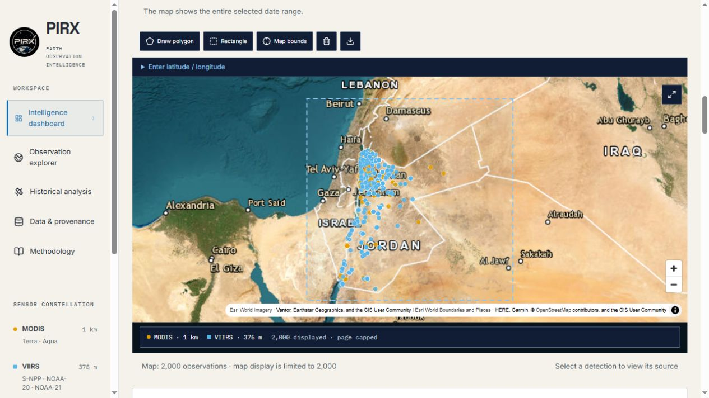
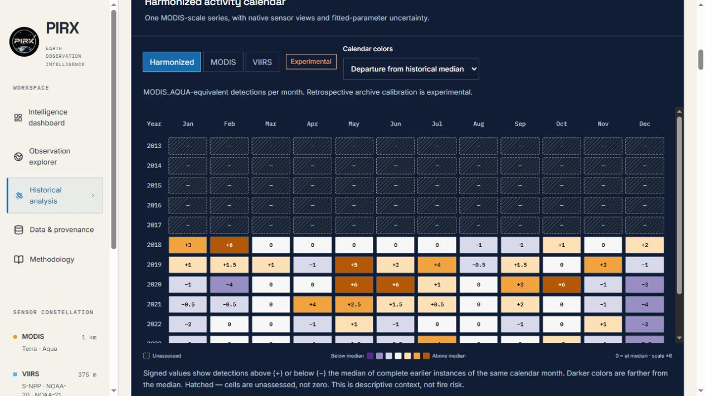
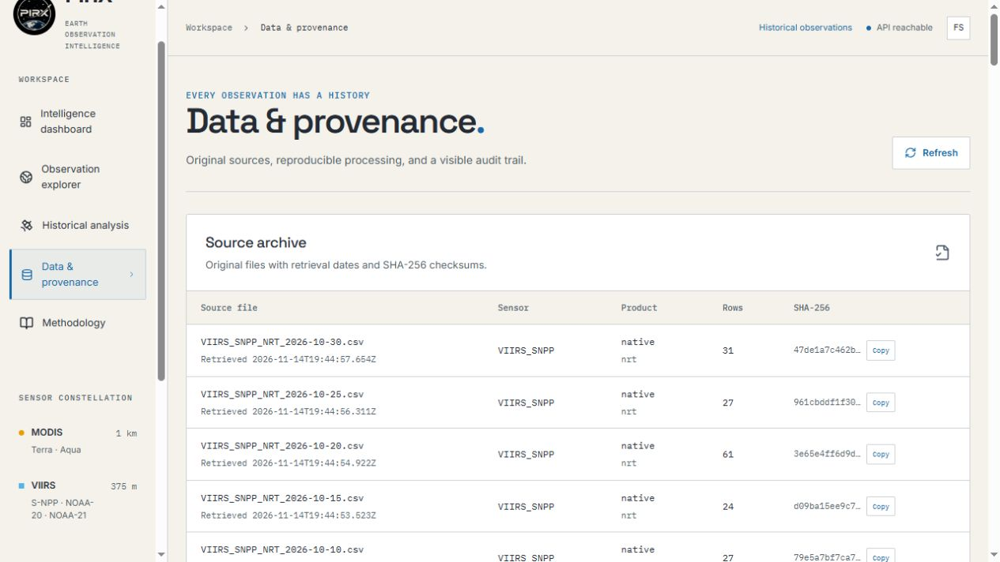

# Judge walkthrough and requirement evidence

PIRX explores a real NASA FIRMS archive and presents a MODIS-scale burning-activity
calendar, native sensor views, descriptive historical comparisons and provenance.
The operational limits below are part of the result, not hidden behind the demo.

## Challenge-to-code mapping

Source: the official NASA Space Apps 2026
[Harmonization of MODIS and VIIRS Hot Spots challenge](https://www.spaceappschallenge.org/2026/challenges/modis-and-viirs-hot-spots/),
including the full Details, Objectives and Potential Considerations sections,
read in the browser on November 15, 2026. Core objectives and explicitly optional
considerations are distinguished below. No requirements are inferred from other
teams' work.

| Challenge objective | Implemented behavior / status | Code evidence | Verification |
| --- | --- | --- | --- |
| Web application for burning-activity exploration | **Implemented.** Dashboard and History routes, map and calendars. | [Dashboard](../frontend/src/pages/Dashboard.tsx), [History](../frontend/src/pages/History.tsx), [API](../backend/app/history_routes.py) | [Dashboard tests](../frontend/src/pages/Dashboard.test.tsx), [History tests](../frontend/src/pages/History.test.tsx) |
| Calendar based on active-fire hotspots | **Implemented.** Year-by-month archive counts, explicit unknowns, selectable sensor views. | [Calendar component](../frontend/src/components/BurningCalendar.tsx), [historical engine](../backend/app/history.py) | [Calendar tests](../frontend/src/components/BurningCalendar.test.tsx), [historical tests](../tests/test_history.py) |
| Time series from the early 2000s to the present | **Implemented for the real Jordan archive, subject to available data.** Resumable annual and API imports respect mission starts and disclosed source gaps. | [Backfill](../data-pipeline/firescope_pipeline/backfill.py), [planner](../data-pipeline/firescope_pipeline/backfill_plan.py), [calendar](../backend/app/harmonized_calendar.py) | [Measured rerun](reports/backfill-judges-summary.json), [restart tests](../tests/test_backfill.py) |
| Harmonize the split MODIS / VIIRS record | **Experimental.** Regression and quantile mapping reuse overlap data to produce one fixed MODIS reference scale; native observations remain available. | [Models](../data-pipeline/firescope_pipeline/calibration/models.py), [calendar builder](../backend/app/harmonized_calendar.py), [validation gates](../data-pipeline/firescope_pipeline/calibration/validation.py) | [Model tests](../tests/test_calibration_models.py), [calendar tests](../tests/test_harmonized_calendar.py), [measured findings](harmonization-results.md) |
| Examine a selected area of interest | **Implemented.** Terra Draw rectangles/polygons, latitude/longitude bounds and validated Polygon/MultiPolygon queries. | [Map](../frontend/src/components/RegionMap.tsx), [coordinate form](../frontend/src/components/CoordinateRegionForm.tsx), [query validation](../backend/app/schemas.py), [spatial filters](../backend/app/repository.py) | [Map tests](../frontend/src/components/RegionMap.test.tsx), [coordinate tests](../frontend/src/components/CoordinateRegionForm.test.tsx), [spatial tests](../tests/test_spatial.py) |
| Select a date range and download analytics/visualizations | **Implemented.** Exact-date map/detection queries, disclosed whole-year historical context, CSV/JSON and SVG/PNG downloads. | [Date controls](../frontend/src/components/DateRangeControl.tsx), [API client](../frontend/src/api.ts), [CSV export](../frontend/src/calendar.ts), [chart export](../frontend/src/components/ScientificChart.tsx) | [Dashboard tests](../frontend/src/pages/Dashboard.test.tsx), [chart export tests](../frontend/src/components/ScientificChart.test.tsx) |
| Examine historical fire patterns | **Implemented as descriptive statistics.** Earlier-year medians, seasonal profiles, matched-month comparisons, trends and source context. | [History statistics](../backend/app/history.py), [median statistics](../backend/app/calendar_statistics.py), [trend](../frontend/src/components/HistoryTrend.tsx) | [Historical tests](../tests/test_history.py), [median tests](../tests/test_calendar_statistics.py) |
| Examine unusual conditions | **Implemented as descriptive comparisons.** Percentile flags and signed departures require complete archives and sufficient earlier years. No invented zeros. | [Median statistics](../backend/app/calendar_statistics.py), [calendar color mode](../frontend/src/components/HarmonizedCalendar.tsx), [color scales](../frontend/src/colorScales.ts) | [Median tests](../tests/test_calendar_statistics.py), [color/contrast tests](../frontend/src/colorScales.test.ts) |
| Help users examine critical periods | **Implemented for historical review.** Seasonal profiles and unusually high/low months are available. Prospective prediction is not claimed. | [Seasonal profiles and thresholds](../backend/app/history.py), [History UI](../frontend/src/pages/History.tsx) | [Science contract](science.md), [historical contract](historical-intelligence.md) |
| Support responder, scientist and land-manager decisions | **Research support.** Source lineage, completeness reasons, experimental/validated labels, exports and explicit uncertainty. Not an operational warning service. | [Source persistence](../data-pipeline/firescope_pipeline/service.py), [schemas](../backend/app/calendar_schemas.py), [exports](../frontend/src/calendar.ts), [Sources UI](../frontend/src/pages/Sources.tsx) | [PostGIS integration](../tests/test_postgis_integration.py), [export tests](../frontend/src/components/HarmonizedCalendar.test.tsx) |

## Optional challenge considerations

The official page explicitly makes these suggestions optional. They are still
supported where shown:

| Optional consideration | Evidence / status |
| --- | --- |
| Interactive map drawing or coordinate entry | **Implemented:** [Terra Draw map](../frontend/src/components/RegionMap.tsx), [latitude/longitude form](../frontend/src/components/CoordinateRegionForm.tsx). |
| Accessible color ramps | **Implemented:** [central scales](../frontend/src/colorScales.ts), [contrast tests](../frontend/src/colorScales.test.ts), [accessibility contract](accessibility.md). |
| Burning calendar and numerical data | **Implemented:** [calendar](../frontend/src/components/BurningCalendar.tsx), [history tables](../frontend/src/pages/History.tsx). |
| Multi-year comparisons and anomalies | **Implemented as descriptive medians and percentiles:** [statistics](../backend/app/history.py), [median comparisons](../backend/app/calendar_statistics.py). |
| Detected/reported fire activity figures | **Implemented as thermal-detection counts:** [summary API](../backend/app/main.py), [dashboard](../frontend/src/pages/Dashboard.tsx). Unique physical fires are not inferred. |
| Outputs for response, science and land-management users | **Research support:** traceable sources, archived exports and explicit limitations; no operational alerting claims. |

## Additional requested project requirements

These are the project's implementation requirements, listed separately from the
official challenge objectives.

| Requirement | Evidence | Status |
| --- | --- | --- |
| Real data from 2000 through today, safe stop/restart, at least one demo region | [`pipeline backfill`](../data-pipeline/firescope_pipeline/backfill.py), [pure planner](../data-pipeline/firescope_pipeline/backfill_plan.py), [CLI](../data-pipeline/firescope_pipeline/cli.py), [measured rerun](reports/backfill-judges-summary.json) | **Implemented for Jordan**, subject to actual mission and source availability. |
| Shared colorblind-safe scales and median calendar mode | [Central palettes](../frontend/src/colorScales.ts), [backend median computation](../backend/app/calendar_statistics.py), [accessibility contract](accessibility.md) | **Implemented**, including signs, hatching, sample years and normal-text cell contrast checks. |
| Pure science functions and matching backend/frontend definitions | [Statistics](../backend/app/calendar_statistics.py), [Pydantic contract](../backend/app/calendar_schemas.py), [generated types](../frontend/src/calendar.types.ts), [generator](../scripts/generate_calendar_types.py) | **Implemented**; contract drift is tested. |
| Honest data and test coverage | [Strict importer](../data-pipeline/firescope_pipeline/ingest.py), [backfill tests](../tests/test_backfill.py), [transactional interruption test](../tests/test_postgis_integration.py) | Synthetic fixtures stay in tests. Screenshots and measured reports use the real archive. |
| Clean entry point and judge evidence | [README](../README.md), this matrix, [screenshots below](#fresh-screenshots) | **Implemented** with linked source and reproduction steps. |

## Five-minute review

1. Open the app's dashboard. Inspect date coverage, native sensor totals and the
   original-source inspector. Draw a rectangle or polygon, or enter coordinates;
   apply filters to query that region.
2. Open History. In Advanced analysis settings, choose **Use Jordan country
   boundary** and analyze. Keep completeness declarations empty; the archive
   establishes supported months from actual source evidence.
3. Switch **Harmonized / MODIS / VIIRS**. Compare native values with the unified
   reference scale, and inspect why a model/month is experimental or unavailable.
4. Select **Calendar colors → Departure from historical median**. Read positive,
   negative and zero departures and their reference years. Early years and
   unsupported periods correctly show hatched unassessed cells.
5. Export the harmonized CSV or full analysis JSON. Review hashes, source metadata,
   uncertainty, baseline reasons and model artifacts. Open Data & provenance to
   inspect the original archive source references.

## Backfill evidence

The November 15, 2026 rerun used a plan with 40 annual country files and four
standard/NRT API ranges. All 40 annual checkpoints were reused and the API
ranges were up to date with lookback disabled. The archive retained 13,079
normalized thermal detections and 164 source files. The
[compact measured report](reports/backfill-judges-summary.json) records catalog
identity, per-source availability, current-day provisional status and gaps.
Dates before mission availability and the currently unsupported S-NPP API tail
are not manufactured into observations. Earlier archived records are retained.

Reproduce using the [backfill guide](backfill.md). Test interruption/resumption
against a disposable PostGIS schema using the [development checks](development.md).

## Scientific limits to assess

- The real Jordan and Levant studies decline operational calibration. Experimental
  calendar fits do not bypass fingerprint, metric, geographic, product-version or
  approval checks. Lower agreement error is not physical-fire validation.
- Complete archive ingestion is distinct from satellite exposure. Cloud, smoke,
  overpass and detection sensitivity uncertainty remain explicit.
- Bootstrap bands describe fitted-parameter uncertainty. Native observation
  uncertainty and unsupported-range bands are not invented.
- No validated fire-risk forecasts, causal environmental analysis, prospective
  warning accuracy or physical-fire counts are claimed.
- Jordan is the reproducible live demo. Other regions need matching real inputs,
  coverage evidence and appropriately evaluated calibration models.

## Fresh screenshots

Captured November 15, 2026 from the running app and real archive. No observations
or completion declarations were inserted for photography. Imagery and source
credits remain part of the application.

**Dashboard map and source-aware sensor colors**

**Jordan historical median departures**

**Original data provenance**

See [accessibility](accessibility.md), [harmonization methodology](harmonization-methodology.md),
[measured findings](harmonization-results.md), and [architecture](architecture.md)
for detailed review.
