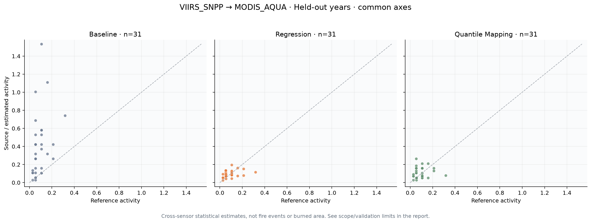
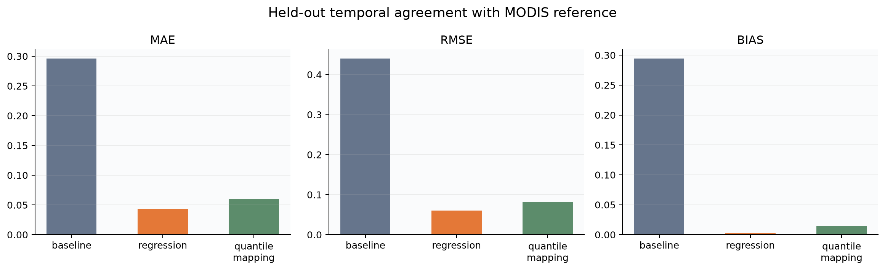
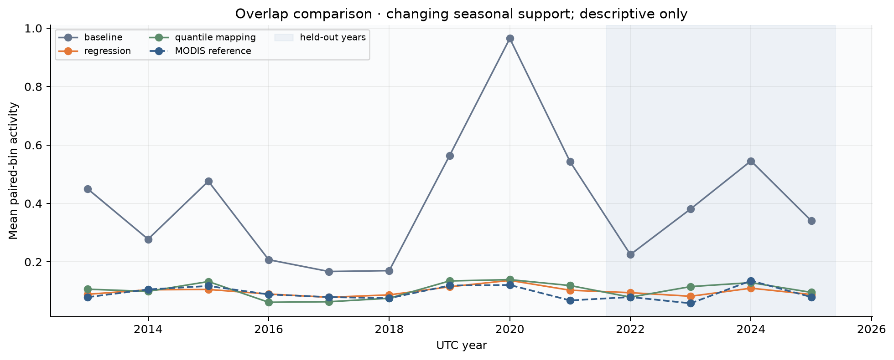

# FireScope sensor harmonization: measured overlap results

This report compares satellite-derived activity, not unique fires or burned area.

Coverage mode: **detection_only_conditional**. Missing bins were not filled with zero.
Reference: MODIS_AQUA; source: VIIRS_SNPP; paired bins: 95; unpaired calendar bins: 529 (both missing: 334).
Spatial grid: 5000 m, EPSG:6933; boundary cells excluded: 90.
Validation-selected method: **regression**.
Operational calibration supported: **False**.

## Held-out temporal results

| Method | Paired bins | MAE | RMSE | Bias (estimate − reference) | Extrapolated fraction |
| --- | ---: | ---: | ---: | ---: | ---: |
| baseline | 31 | 0.29636 | 0.440468 | 0.294608 | 0 |
| regression | 31 | 0.0430498 | 0.0603434 | 0.00314541 | 0 |
| quantile_mapping | 31 | 0.0601374 | 0.082409 | 0.014654 | 0.129032 |

## Validation limits

- test_years:trend_not_estimable
- test_regions:insufficient_pairs
- test_years_and_regions:insufficient_pairs
- observability_unknown_conditional_detection_comparison_only
- metric_is_detection_only_proxy
- native_product_transition_evaluation_only

## All blocked test scenarios

| Method | Scenario | Pairs | Trend estimable |
| --- | --- | ---: | --- |
| baseline | test_years | 31 | False |
| baseline | test_regions | 0 | False |
| baseline | test_years_and_regions | 0 | False |
| regression | test_years | 31 | False |
| regression | test_regions | 0 | False |
| regression | test_years_and_regions | 0 | False |
| quantile_mapping | test_years | 31 | False |
| quantile_mapping | test_regions | 0 | False |
| quantile_mapping | test_years_and_regions | 0 | False |

The method was selected using validation data only. Test years and held-out regions were not used in fitting or selection.
Year-block bootstrap intervals quantify finite-sample agreement/parameter variability only, not physical detection uncertainty.
Native versions are retained below; numeric labels are not silently translated into collection identifiers.

```json
{
  "MODIS_AQUA": [
    "6.03",
    "6.2",
    "61.03"
  ],
  "MODIS_TERRA": [
    "6.03",
    "6.2",
    "61.03"
  ],
  "VIIRS_SNPP": [
    "2"
  ]
}
```

## Figures







## Provenance

26 hash-verified original CSV files; see full-bundle-manifest.json.
sensor-observations.csv preserves normalized input sensor records and source hashes; source CSV bytes remain in the original archive.
sensor-monthly.csv retains individual sensors and strata; all-pairs-including-missing.csv retains unpaired bins.
candidate-predictions.csv contains statistical estimates separately from observations.

This directory is a curated result summary. The complete normalized observation audit and grid tables remain in the ignored full analysis bundle at `reports/harmonization/jordan-v1`; regenerate that full bundle before database registration.
